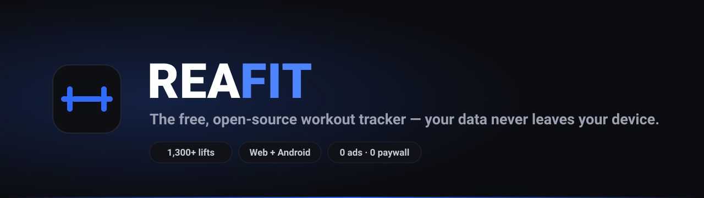

<div align="center">



**The open-source Hevy alternative. Log every set, watch your body map light up, share workouts with friends — free forever, no ads, no paywall, no cloud.**

[](https://github.com/shogun-support-99/Fitness-REA/releases)
[](LICENSE)
[](#take-it-to-the-gym)
[](CONTRIBUTING.md)

**[🌐 Website / landing page](https://shogun-support-99.github.io/Fitness-REA/)** ·
**[🚀 Open the web app](https://shogun-support-99.github.io/Fitness-REA/#/app)** ·
**[🤖 Download the Android APK](https://github.com/shogun-support-99/Fitness-REA/releases/latest/download/rea-fit.apk)**

</div>

---

## Take it to the gym

| | Link | Good to know |
| :--- | :--- | :--- |
| 🌐 **Web app** | [Open it now](https://shogun-support-99.github.io/Fitness-REA/#/app) | No install, any device, always up to date |
| 🤖 **Android app** | [Download `rea-fit.apk`](https://github.com/shogun-support-99/Fitness-REA/releases/latest/download/rea-fit.apk) | Small download, works offline, installs like any app |

**Your data lives on your device — full stop.** Accounts, workouts, routines and your feed are
stored in the app's private local storage on your phone or in your browser. Nothing is uploaded,
there is no server, and you can export a JSON backup any time from Profile → Data.

## What is this?

A [Hevy](https://www.hevyapp.com/)-inspired workout tracker that runs entirely in the browser (and
now on Android). Everything Hevy puts behind a subscription is free here, because there's no
backend to pay for:

- **🏋️ Workout logger** — add exercises, log weight × reps per set, mark warm-up / drop / failure
  sets, ghost auto-fill from your last session, live set/volume/duration telemetry, and a persistent
  active-workout bar so your session survives browsing away.
- **⏱️ Rest timer** — starts automatically when you complete a set (drop sets skip it), with
  +15s / +1m extensions and a completion chime.
- **🧮 Calculators** — barbell plate calculator and a one-tap warm-up ladder (50%×5 / 70%×3 /
  90%×1) rounded to real plate increments.
- **🏆 Personal records** — live PR toasts the moment a set beats your best estimated 1RM, plus a
  full PR breakdown after every workout.
- **🫀 Body distribution** — a front/back anatomical muscle heatmap of sets per muscle group for
  any day or week, with the 10–20 sets/week hypertrophy zone marked.
- **📅 Routines** — build templates once, start any session with one tap; change a routine
  mid-workout and the app offers to update the template. Repeat past workouts or save them as
  routines.
- **🔐 Accounts** — free local accounts with a proper login page. Passwords are hashed on-device
  and every account keeps its own data; a guest mode needs no signup at all.
- **👥 Feed & contacts** — a real social feed: likes, comments and shareable workouts. Add
  training partners as contacts and follow the athletes you rate.
- **🔗 Workout sharing** — share any workout as a link that works through any messenger. The
  recipient opens a public viewer and adds it to their own feed. No server involved.
- **⚡ Live PR alerts** — celebrate the moment they happen, not at the end.
- **📚 Exercise library** — 1,300+ built-in exercises with equipment and muscle filters, demo
  media and instructions, plus custom exercise creation. Strength and cardio set types.
- **⚙️ Settings** — kg / lb units (converted live), dark & light themes, rest timer length, sounds,
  and JSON export / import of all your data.

## The Android app

The APK is this same codebase wrapped in a thin WebView shell
([`android/`](android)) — built and signed automatically by
[GitHub Actions](.github/workflows/android.yml) on every change, straight from the repo:

- The whole web app is bundled inside the APK — it works **fully offline** (exercise images load
  from a CDN when you're online).
- Your data lives in the app's private storage on the phone — uninstalling removes it, nothing
  else ever sees it.
- Served over `https://appassets.androidplatform.net` internally, so password hashing and
  clipboard sharing work exactly like on the web.

Install: download `rea-fit.apk`, open it, and allow installs from your browser once when Android
asks. Updates install over previous builds.

## Run it locally

```bash
npm install
npm run dev        # http://localhost:5173
```

Production build:

```bash
npm run build      # outputs to dist/
npm run preview
```

Tests (no framework needed — plain node):

```bash
npm run test:auth    # accounts: signup, sessions, migration, data isolation
npm run test:logic   # training math, reducer, feed/social, warm-up + routine diffing
npm run test:render  # SSR smoke test of every screen
```

## Deploy

A GitHub Actions workflow (`.github/workflows/deploy.yml`) builds and publishes the web app to
**GitHub Pages** on every push to `main`. The Android workflow (`.github/workflows/android.yml`)
builds and publishes the APK to the release.

## Tech

- **React 18 + TypeScript + Vite** — zero UI dependencies; every icon, chart and the anatomical
  body map are hand-rolled SVG.
- **Hash routing** (`#/` landing, `#/app` tracker) so it works on any static host and subpath —
  and inside the APK.
- **localStorage persistence** with a typed reducer store and per-account data keys — workouts,
  routines, settings, feed state and an in-progress workout survive reloads and app restarts.
- Weights are stored in kilograms internally and converted for display, so switching units never
  corrupts history.

```
src/
  app/            tracker app (shell, tabs, screens, body map)
  landing/        marketing page
  lib/            store, types, training math, accounts, share codes
  data/           exercise database
  components/     icons, charts, shared UI
android/          WebView shell + CI signing for the APK
scripts/          logic + render + auth tests
```

## Disclaimer & credits

This is an independent, open-source project built as a tribute to [Hevy](https://www.hevyapp.com/)'s
excellent design. It is **not affiliated with or endorsed by Hevy**, and all content and code here
were written from scratch.

**Exercise data** (names, muscles, equipment, instructions) comes from
[hasaneyldrm/exercises-dataset](https://github.com/hasaneyldrm/exercises-dataset), released under
the **MIT License** — see [`THIRD_PARTY_NOTICES.md`](THIRD_PARTY_NOTICES.md).

**Exercise media** (thumbnail images and animation GIFs, hotlinked at 180×180 from the CDN) is the
property of **© Gym visual — [https://gymvisual.com/](https://gymvisual.com/)**, used with
attribution and not for commercial use.

## License

MIT — see [LICENSE](LICENSE).
